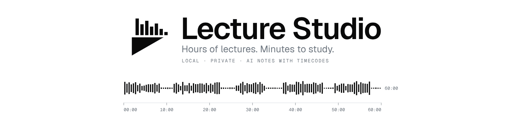

<p align="center">
  <picture>
    <source media="(prefers-color-scheme: dark)" srcset="assets/banner/banner-dark-en.gif">
    <source media="(prefers-color-scheme: light)" srcset="assets/banner/banner-light-en.gif">
    
  </picture>
</p>

<p align="center">
  Turn hours of recorded lectures into something you can study in minutes.<br>
  Local and private, for macOS and Windows.<br>
  <sub>Alpha: it works, but expect rough edges. Report bugs with the Feedback button in the app.</sub>
</p>

<p align="center">
  <b>English</b> · <a href="README.ru.md">Русский</a>
</p>

---

Lecture Studio takes a recorded lecture or screencast, cuts out the silence, transcribes it and writes blunt,
slide-style notes with clickable timecodes. Then you can ask questions across your lessons and jump straight to the
moment in the video where the answer is. It all runs on your computer; your video stays there unless you ask otherwise.

It was built for one person's programming courses and is shared as is: no roadmap, no support promise.

## What it does

- **Cuts the silence.** Pauses go from the sound and the video at the same frames, so both stay in sync.
- **Transcribes.** Whisper on your own GPU or CPU, or Gemini in the cloud (sound only).
- **Writes the notes.** DeepSeek, Gemini, ChatGPT, Claude (API key or your plan through Claude Code) or a local model (Ollama, LM Studio) turns the transcript into short notes with `[MM:SS]` timecodes you can
  click, in the language you choose.
- **Answers with citations.** Ask one lesson or a whole course; answers link to the exact moment ("Lesson 2 · 04:15").
- **Works with your Claude.** On your subscription, no API key: pick "Claude Code · plan" and your own signed-in
  Claude Code answers right in the app's chat and writes audits; or connect Claude Desktop / Claude Code in one click
  (MCP) and they read your lessons and write audits themselves.
- **Finds lectures on YouTube.** Search and watch in the **Videos** tab, or paste a link; one click downloads it
  (yt-dlp on your computer, up to 1080p) and opens it in the Studio. Download only what you have the rights to.
- **A real workspace.** Player with marks, synced transcript, notebooks, a Markdown diary, export to Obsidian.
- **Stays up to date.** New versions arrive inside the app; if one fails to start, the previous one comes back.

## Install

1. **Get the code:** download the ZIP (**Code → Download ZIP** at the top of this page) and unzip it, or
   `git clone https://github.com/MARBORZ/lecture-studio.git`. A clone updates itself; a ZIP only says a new version is out.
2. Open **`setups`**, then your system: **`macos`** or **`windows`**.
3. Run **Setup** (`Setup.cmd` on Windows). On a Mac, the first time: right-click → Open, the app is not notarized.

On a Mac you can also take **Lecture-Studio-Setup.zip** from [Releases](https://github.com/MARBORZ/lecture-studio/releases):
its interface is already built, so Node.js is not needed.

Setup installs what is missing (uv, FFmpeg, Node.js to build the interface; Homebrew on a Mac), takes 5–15 minutes and puts
**Lecture Studio** on your Desktop. It speaks Russian on a Russian system and English everywhere else.

Then open the app. The tutorial asks how to connect AI (change it any time in **Settings → AI**):

- **Claude on your subscription, no keys needed.** With Claude Code installed and signed in, pick **Claude Code · plan**:
  it answers in the app's chat and writes the audits. And one click gives Claude Desktop or Claude Code the lesson
  library: it reads transcripts, searches and writes audits, and they show up in the app
  ([how it works](docs/MCP_SETUP.md)).
- **An API key** of **DeepSeek**, **Gemini**, **ChatGPT** (OpenAI) or **Claude** (Anthropic): the audit is written
  right after processing, and the assistant answers inside the app.
- **Fully local and free:** install [Ollama](https://ollama.com), run `ollama pull qwen3:8b` (or any model you like), then
  pick it in **Settings → AI → Local model**. Whisper transcribes on your machine, the local model writes the notes and
  answers questions: no key, no account, nothing leaves the computer. It is slower than the cloud, and a small model
  reads a long lecture in parts.

Or skip it: cutting, the clean video and the Whisper transcript work without AI. Then drop a recording into the **Studio**.

## Delete

**Settings → Interface → Delete Lecture Studio**, or `setups` → your system → **Uninstall** without opening the app.
Your lessons stay unless you tick "Delete lessons too".

## Privacy

- Video is processed on your computer. Cloud models get only sound (if you pick Gemini transcription) or text.
- The one exception is opt-in: an **audit from video** sends Gemini a light 480p copy so it can read code on screen.
- API keys are kept only on your computer, in the app's settings.
- The **Videos** tab talks to YouTube only when you search, open or download a video.
- With Whisper and a local model (or no AI notes), nothing leaves the machine at all.

## Requirements

| | macOS | Windows |
|---|---|---|
| System | Apple Silicon recommended | Windows 10 / 11 |
| Fast transcription | Apple GPU (MLX) | NVIDIA GPU (CUDA), picked automatically |
| Settings, keys, logs | `~/Library/Application Support/Lecture Studio` | `%APPDATA%\Lecture Studio` |

Lessons live in a folder you choose (Settings → Paths), never inside the app.
Windows is tested on one machine (Windows 11, RTX 3080). Linux has no installer.

## Development

```bash
uv sync && uv run uvicorn backend.main:app --port 3000 --reload
npm --prefix frontend run dev        # http://127.0.0.1:5173
uv run pytest && uv run ruff check . && npm --prefix frontend run lint
```

FastAPI, Faster-Whisper, Silero VAD, FFmpeg, React 19, Vite, Tailwind 4. How it is built, how to release: [docs/](docs/README.md).

## License

[MIT](LICENSE): use it, change it, share it. Provided as is, without warranty.
