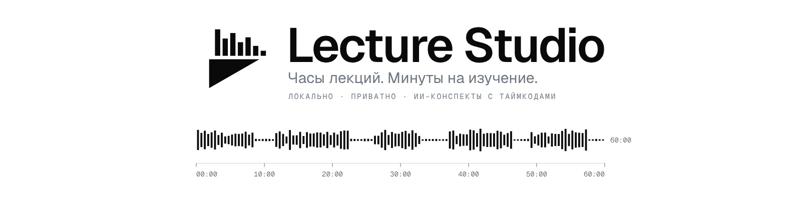

<p align="center">
  <picture>
    <source media="(prefers-color-scheme: dark)" srcset="assets/banner/banner-dark-ru.gif">
    <source media="(prefers-color-scheme: light)" srcset="assets/banner/banner-light-ru.gif">
    
  </picture>
</p>

<p align="center">
  Часы записанных лекций — в материал, который изучается за минуты.<br>
  Локально и приватно, для macOS и Windows.<br>
  <sub>Альфа: работает, но возможны шероховатости. О багах — кнопкой «Обратная связь» в приложении.</sub>
</p>

<p align="center">
  <a href="README.md">English</a> · <b>Русский</b>
</p>

---

Lecture Studio берёт запись лекции или скринкаст, вырезает тишину, распознаёт речь и пишет жёсткий конспект в стиле
слайдов с кликабельными таймкодами. Дальше можно задавать вопросы по своим урокам и сразу прыгать в тот момент видео,
где прозвучал ответ. Всё работает на вашем компьютере; видео остаётся у вас, если вы сами не решите иначе.

Проект сделан под личные курсы по программированию и выложен как есть: без планов развития и обещаний поддержки.

## Что умеет

- **Вырезает тишину.** Паузы уходят из звука и видео по одним и тем же кадрам, поэтому они не расходятся.
- **Распознаёт речь.** Whisper на вашей видеокарте или процессоре, либо Gemini в облаке (только звук).
- **Пишет конспект.** DeepSeek, Gemini или локальная модель (Ollama, LM Studio) превращает стенограмму в короткие тезисы с кликабельными таймкодами
  `[MM:SS]` — на языке, который вы выберете.
- **Отвечает со ссылками.** Спросите один урок или весь курс: ответ ведёт в нужный момент («Урок 2 · 04:15»).
- **Рабочее место.** Плеер с метками, синхронная стенограмма, блокноты, дневник в Markdown, экспорт в Obsidian.
- **Обновляется сама.** Новые версии приходят прямо в приложении; если новая не запустится, вернётся прежняя.

## Установка

1. **Скачайте код:** ZIP (**Code → Download ZIP** вверху страницы) и распакуйте, или
   `git clone https://github.com/MARBORZ/lecture-studio.git`. Клон обновляется сам; ZIP только сообщает о новой версии.
2. Откройте **`setups`**, затем свою систему: **`macos`** или **`windows`**.
3. Запустите **Setup** (`Setup.cmd` на Windows). На Mac в первый раз: правой кнопкой → «Открыть», приложение не нотаризовано.

На Mac можно взять и **Lecture-Studio-Setup.zip** из [Releases](https://github.com/MARBORZ/lecture-studio/releases):
интерфейс в нём уже собран, Node.js не нужен.

Setup доставит недостающее (uv, FFmpeg, Node.js для сборки интерфейса; на Mac ещё Homebrew), займёт 5–15 минут и положит
**Lecture Studio** на Рабочий стол. На русской системе он говорит по-русски, на остальных — по-английски.

Затем откройте приложение, вставьте ключ **DeepSeek** и/или **Gemini** в **Настройки → ИИ** и перетащите запись в **Студию**.

**Полностью локально и бесплатно:** установите [Ollama](https://ollama.com), выполните `ollama pull qwen3:8b` (или любую
другую модель) и выберите её в **Настройки → ИИ → Локальная модель**. Whisper распознаёт речь на компьютере, локальная
модель пишет конспект и отвечает на вопросы: без ключа, без аккаунта, ничего не уходит в сеть. Это медленнее облака,
а маленькая модель читает длинную лекцию частями.

## Удаление

**Настройки → Интерфейс → Удалить Lecture Studio** или, не открывая приложение, `setups` → ваша система → **Uninstall**.
Уроки остаются, если не отметить «Удалить и уроки».

## Приватность

- Видео обрабатывается на вашем компьютере. Облачные модели получают только звук (если выбрано распознавание Gemini) или текст.
- Единственное исключение включается вручную: **аудит по видео** отправляет Gemini лёгкую копию 480p, чтобы он видел код на экране.
- Ключи API хранятся только на вашем компьютере, в настройках приложения.
- С Whisper и локальной моделью (или без конспекта от ИИ) с компьютера не уходит ничего.

## Требования

| | macOS | Windows |
|---|---|---|
| Система | лучше Apple Silicon | Windows 10 / 11 |
| Быстрое распознавание | GPU Apple (MLX) | GPU NVIDIA (CUDA), выбирается сам |
| Настройки, ключи, логи | `~/Library/Application Support/Lecture Studio` | `%APPDATA%\Lecture Studio` |

Уроки лежат в папке, которую вы выберете (Настройки → Пути), и никогда внутри приложения.
Windows проверена на одной машине (Windows 11, RTX 3080). Для Linux установщика нет.

## Разработка

```bash
uv sync && uv run uvicorn backend.main:app --port 3000 --reload
npm --prefix frontend run dev        # http://127.0.0.1:5173
uv run pytest && uv run ruff check . && npm --prefix frontend run lint
```

FastAPI, Faster-Whisper, Silero VAD, FFmpeg, React 19, Vite, Tailwind 4. Как всё устроено и как выпускать версии: [docs/](docs/README.md) (на английском).

## Лицензия

[MIT](LICENSE): пользуйтесь, меняйте, делитесь. Предоставляется как есть, без гарантий.
